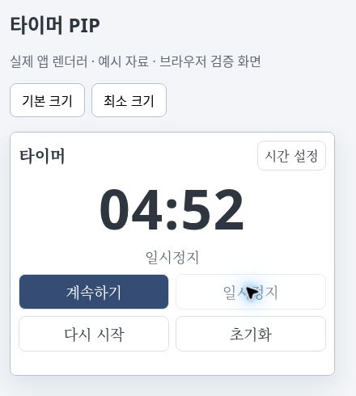

# 타이머 PIP 사용 안내

전국용과 옥구초 전용에 공통으로 추가한 기능입니다. 이 문서는 개발 변경을 설명하며, 기존 배포 설치 파일에 이미 포함되었다는 뜻은 아닙니다. 배포 전 검증 상태는 `tests/validation/2026-11-05-timer-pip.md`에서 확인하세요.

1. 화면 아래 **⏱ 타이머**를 누릅니다.
2. 1·3·5·10·15분 중 하나를 고르거나 분·초를 입력하고 **직접 입력 적용**을 누릅니다.
3. 타이머 창 오른쪽의 **PIP로 보기**를 누릅니다.
4. 작은 창에서 **시작**, **일시정지**, **계속하기**, **다시 시작**, **초기화**를 사용할 수 있습니다.

| 버튼 | 동작 |
| --- | --- |
| 시작 | 설정한 시간으로 시작합니다. 종료 상태에서도 설정한 시간으로 시작합니다. |
| 일시정지 | 현재 남은 시간을 보관합니다. |
| 계속하기 | 일시정지한 시간부터 이어서 진행합니다. |
| 다시 시작 | 설정한 전체 시간으로 돌아가 곧바로 진행합니다. |
| 초기화 | 진행을 멈추고 설정한 시간의 대기 상태로 돌아갑니다. |
| 확인 | 시간이 끝난 뒤 종료 알림을 지우고 설정한 시간의 대기 상태로 돌아갑니다. |
| 시간 설정 | 본창의 타이머를 열고 PIP 창을 닫습니다. 시간과 종료 알림음은 본창에서 설정합니다. |

본창과 PIP는 같은 타이머를 사용합니다. 어느 창에서 조작하든 다른 창에도 반영됩니다. PIP 창만 닫으면 타이머는 계속 진행하며, 다시 열면 현재 남은 시간이 보입니다. 본창을 최소화한 동안에도 타이머가 진행되도록 기존 데스크톱 설정을 사용합니다. 프로그램 전체를 종료하면 PIP 창도 닫힙니다.

작은 창은 항상 위에 표시되도록 설정되며, 위치와 크기를 조절할 수 있습니다. 타이머의 위치·크기는 다른 PIP 화면과 별도로 기억합니다. 기존처럼 PIP 창은 하나를 재사용하므로 다른 기능의 PIP를 열면 그 내용으로 전환됩니다.

위 이미지는 실제 앱 렌더러를 예시 데이터와 브라우저용 연결 코드로 실행한 화면입니다. Windows 네이티브 창의 캡처가 아닙니다.
